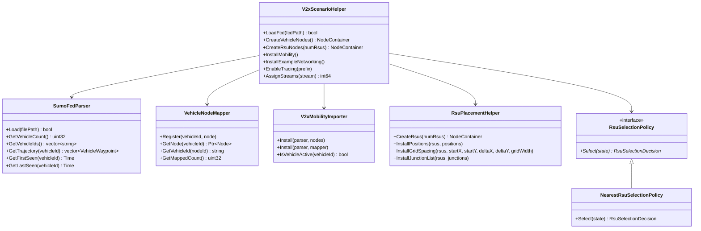

# FutureNet M09 Architecture & Design Specification

## 1. System Overview
Module `futurenet-v2x` provides an extensible, standard-compliant vehicular network simulation framework for ns-3.46.1. It bridges offline microscopic road mobility generated by Eclipse SUMO with ns-3 network protocol stacks and Roadside Unit (RSU) infrastructure.

```
       +---------------------------------------------+
       |             SUMO FCD Trajectory             |
       +---------------------------------------------+
                              |
                              v
       +---------------------------------------------+
       |                SumoFcdParser                |
       |  - Stream XML reader                        |
       |  - Scale & Offset coordinate transformer    |
       +---------------------------------------------+
                              |
                              v
       +---------------------------------------------+
       |              VehicleNodeMapper              |
       |  - Deterministic sorted ID mapping          |
       |  - Bi-directional lookup (string <-> nodeId)|
       +---------------------------------------------+
                              |
                              v
       +---------------------------------------------+
       |             V2xMobilityImporter             |
       |  - WaypointMobilityModel installation       |
       |  - Dynamic departure/arrival lifecycle      |
       |  - Sampled position tracing (MobilityStep)  |
       +---------------------------------------------+
                              |
                              v
       +---------------------------------------------+
       |              V2xScenarioHelper              |
       |  - Orchestrates nodes, Wi-Fi ad hoc, IP     |
       |  - RsuPlacementHelper (grid / coords / junc)|
       |  - NearestRsuSelectionPolicy baseline       |
       |  - FlowMonitor & CSV Telemetry Exporter     |
       +---------------------------------------------+
```

## 2. Component Descriptions

### 2.1 `SumoFcdParser`
- Derived from `ns3::Object` with Attributes `CoordinateScale`, `CoordinateOffsetX`, and `CoordinateOffsetY`.
- Reads XML timestep entries in $O(N)$ streaming fashion.
- Validates XML attributes and raises clear error messages on malformed/missing files.

### 2.2 `VehicleNodeMapper`
- Maintains bidirectional maps: `std::map<std::string, Ptr<Node>>` and `std::map<uint32_t, std::string>`.
- Guarantees deterministic assignment by sorting vehicle IDs alphabetically before assigning ns-3 nodes.

### 2.3 `V2xMobilityImporter`
- Converts parsed waypoints into ns-3 `WaypointMobilityModel`.
- Schedules `VehicleActivated` and `VehicleDeactivated` events.
- Periodically samples vehicle positions based on `MobilityStep` (10 ms – 2 s).

### 2.4 `RsuSelectionPolicy` (Mechanism/Policy Split)
- Pure virtual interface `RsuSelectionPolicy::Select(const RsuSelectionState& state)`.
- Implements `NearestRsuSelectionPolicy` baseline.
- Downstream modules (such as M10 Agent) can inject reinforcement learning or load-balanced selection without modifying simulation core.

### 2.5 Network Architecture & Telemetry Ports
- **V2I Unicast**: Transmitted to nearest RSU IP address on port `9999` (`V2xScenarioHelper::V2I_PORT`).
- **V2V Broadcast**: Transmitted to subnet directed broadcast address on port `9998` (`V2xScenarioHelper::V2V_PORT`).
- **Addressing**: IPv4 `10.1.0.0/16` with dynamically computed directed broadcast address.
- **Delivery & Loss Telemetry**:
  - Unicast V2I: $\text{PDR}_{\text{V2I}} = \frac{\text{Rx}_{\text{V2I}}}{\text{Tx}_{\text{V2I}}}$, with packet loss $\text{Lost} = \text{Tx}_{\text{V2I}} - \text{Rx}_{\text{V2I}}$.
  - Sequence Gaps: Computed across all links using `SeqTsHeader` sequence numbers.

### 2.6 Deliverable D4 Mapping Table
| Target Requirement | Example Executable | Source Location | Description |
| :--- | :--- | :--- | :--- |
| **`example-basic`** | `example-grid` | `examples/example-grid.cc` | Baseline grid scenario (16 vehicles, 4 RSUs), grid/explicit RSU placement, periodic V2V/V2I, 3-tier CSVs. |
| **`example-advanced`** | `example-map` | `examples/example-map.cc` | Ingestion of arbitrary maps/traces, coordinate scaling/offset, FlowMonitor XML export, controlled variation. |

### 2.7 Complexity Analysis of Nearest-RSU Association
In vehicular deployments, the number of active vehicles is $N$ and the number of deployed roadside units is $R$. The association policy evaluates the Euclidean distance between each active vehicle and available RSUs at each association interval:
$$\mathcal{O}(N \times R)$$
In typical road topologies, $R$ is fixed and small ($R \in [1, 20]$), making the per-tick complexity strictly linear in the active vehicle count: $\mathcal{O}(N)$. In benchmark tests with 100 vehicles and 4 RSUs, this scan completes in $< 15\,\mu\text{s}$ per evaluation step, avoiding unnecessary spatial partitioning tree (quadtree/BVH) memory and pointer maintenance overhead.

## 3. Class Diagram



## 4. Known Limitations (QG-10)

1. **Offline Trace Ingestion**: `SumoFcdParser` ingests SUMO Floating Car Data XML files offline. Dynamic closed-loop feedback into SUMO driver behavior (e.g., re-routing or braking triggered by received V2X alerts) is outside the scope of M09 and targeted for M10.
2. **TraCI Live Adapter Prototype**: `tools/live_traci_adapter.py` is provided as an experimental prototype demonstrating socket connectivity and frame extraction, but does not provide lockstep ns-3 co-simulation.
3. **2D vs 3D Coordinates**: Standard SUMO networks emit 2D $(x, y)$ coordinates with $z=0.0$. RSU elevation is added explicitly via `RsuHeight` (default 5.0 m).
4. **Wireless Channel Congestion**: At very high vehicle densities ($> 500$ vehicles in a single Wi-Fi broadcast range), standard 802.11p CSMA/CA contention will experience packet collisions and frame drops, as physically expected in 5.9 GHz DSRC spectrum.
